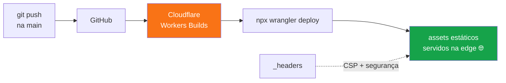

# ☁️ Deploy com Cloudflare Workers

Guia completo de como este jogo vai ao ar — e de como refazer do zero.

## 🌐 Endpoint ao vivo

**https://jogo-da-forca.vitorsavicki.workers.dev/**

Cada `git push` na `main` dispara **build + deploy automáticos**
(Cloudflare Workers Builds). Push → ~30s → site novo no ar. 🤖

## 🧩 Como funciona (arquitetura)



## ⚙️ O wrangler.json (o coração)

```json
{
  "name": "jogo-da-forca",
  "compatibility_date": "2026-10-12",
  "assets": { "directory": "./" }
}
```

- `name` → vira o subdomínio: `jogo-da-forca.<sua-conta>.workers.dev`
- `assets.directory: "./"` → o Worker serve os arquivos estáticos do repo
  (sem código de Worker escrito à mão!)
- `_headers` na raiz → headers de segurança aplicados em todas as respostas

## 🚀 Passo a passo do zero (reproduzindo)

### 1. Pré-requisitos
- Conta grátis na [Cloudflare](https://dash.cloudflare.com/sign-up)
- Este repo no seu GitHub

### 2. Conectar o repo (deploy automático)
1. Dashboard Cloudflare → **Workers & Pages** → **Create**
2. Escolha **"Import a repository"** (não é o botão de Worker vazio!)
3. Conecte sua conta GitHub e selecione este repositório
4. Configure:
   - **Deploy command**: `npx wrangler deploy`
   - **Version command** (preview): `npx wrangler versions upload`
   - O `wrangler.json` do repo é detectado sozinho ✅
5. **Save and Deploy**

### 3. Ajustes pós-deploy
- **Cloudflare Access**: deixe **desligado** (site público) —
  Settings do Worker → Access → OFF
- O endpoint `*.workers.dev` já sai com HTTPS ✅

### 4. Alternativa: deploy manual pelo terminal

```powershell
npx wrangler login      # abre o browser para autenticar
npx wrangler deploy     # sobe a versão atual
```

## 🔁 O ciclo do dia a dia

```powershell
git add -A
git commit -m "minha mudança"
git push     # CI roda + Cloudflare rebuilda + site atualiza sozinho
```

## 🌍 Domínio próprio (opcional)

Com um domínio seu na Cloudflare: Worker → **Settings → Domains & Routes**
→ **Add Custom Domain** → escolha o domínio → pronto, HTTPS automático.
